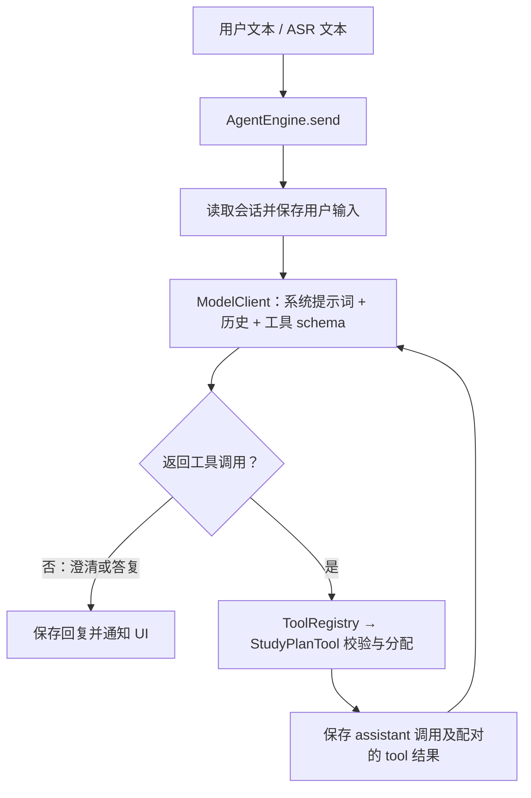

# A 部分：学习任务规划助手

> 本文记录保留的短期时间分配工具。产品已扩展为[学习方向与行动规划 Agent](Agent学习方向与行动规划说明.md)；旧四轮示例使用 `npm.cmd run demo:study`，主 `demo` 展示新产品流程。

## 目标与边界

选题为学习任务规划助手。沿用现有 AgentEngine、ModelClient、AgentTool、SessionRepository 接口，在同一份共享源码中实现“补充条件 → 校验任务 → 计算计划 → 回传结果 → 解释结果”。

用户提供目标、可用天数、每天可用分钟数，以及任务列表和各项预计耗时。缺少条件时只询问缺失项；后续轮次沿用已确认条件，修改以最近输入为准。任务耗时是估计，不保证学习效果。暂不添加日历、提醒、联网搜索、RAG 或多 Agent。

## 方案与执行规则

参考 [LangGraph.js](https://github.com/langchain-ai/langgraphjs) 的有状态 Agent 编排思路，继续完善本仓库的轻量执行循环。没有引入其 npm 依赖，也没有复制第三方代码；这样可保持原有公共接口并减少端侧兼容性验证工作。

- 工具名称保持 `create_study_plan`；输入增加必填 `minutesPerDay` 和 `tasks`。
- `days` 为 1–30 整数，`minutesPerDay` 为 1–1440 整数；这些是校验范围，不是建议学习时长。
- `tasks` 为 1–50 项，每项含 `name`（1–100 字）和 `minutes`（1–43200 整数）。`goal` 为 1–200 字。拒绝未声明字段。
- 按任务输入顺序安排，允许同一任务跨天拆分；每天总时长不超过用户给定上限。空闲天明确显示未安排任务，不虚构新任务。
- 总预计耗时超过总可用时间时返回失败和分钟缺口，不生成超额计划。
- 工具失败结果先回传模型，允许在本轮修正参数；错误按工具名记录，仅同名工具再次成功才解除其错误。若最后仍失败，Agent 返回 `failed` 和实际工具错误，防止模型或无关工具成功掩盖失败。
- 保留每轮最多 4 次模型请求、每步最多 8 次工具请求及同会话并发保护。
- 云端自然语言理解由 C 的真实模型完成；离线模型仅用于可重复的参数补充演示。

## 验收样例

| 场景 | 输入条件 | 应有行为 |
| --- | --- | --- |
| 成功 | 3 天，每天 90 分钟；极限 60、导数 90、积分 120 分钟 | 总计 270 分钟，三天各安排 90 分钟，任务无遗漏或重复计时 |
| 澄清 | 第一轮只有“复习高数”，第二轮补充时间和任务 | 第二轮保留第一轮目标，条件齐全后调用工具 |
| 时间不足 | 3 天，每天 30 分钟；任务 360 分钟 | 报告可用 90 分钟、缺少 270 分钟，提示调整条件 |
| 修改与恢复 | 同一会话减少每日时间后再增加天数 | 重新计算；保留目标和任务，不串到其他会话 |

## 实际调用顺序与状态



正常计划状态为 `thinking → using_tool → thinking → completed`。澄清只经过 `thinking → completed`；这里 completed 表示本轮答复完成，不能单凭它判断计划已生成。未恢复的工具错误进入 failed，模型与存储失败也明确反馈；工具结果和请求保持调用 ID 配对。

## 离线运行与结果

在仓库根目录执行：

```powershell
npm.cmd run check
npm.cmd run demo:study
```

离线模型只接受 JSON 参数，可分轮发送：

```json
{"goal":"复习高数"}
```

```json
{"days":3,"minutesPerDay":90,"tasks":[{"name":"极限","minutes":60},{"name":"导数","minutes":90},{"name":"积分","minutes":120}]}
```

得到的三天安排分别是“极限 60 + 导数 30”“导数 60 + 积分 30”“积分 90”，每天均为 90 分钟。

继续发送 `{"minutesPerDay":60}` 会报告可用 180 分钟、缺少 90 分钟；再发送 `{"days":5}` 则保留目标和任务，生成五天安排并剩余 30 分钟。同一 runtime 的其他会话不会继承这些条件。

应用的 `复习高数|3` 生成并保存基础按天计划；按分钟排期请用上述分轮 JSON 条件。无效格式仅返回离线使用提示，不将其当成自然语言已理解，也不会再次执行已有计划。

## 工具协议与失败处理

`create_study_plan` 输入的四个必填字段是 `goal`、`days`、`minutesPerDay`、`tasks`。完整 schema 由 `StudyPlanTool.definition()` 提供，C 使用它发送模型请求，不再手写一份固定参数定义。工具结果仍为 `{ name, success, content }`，content 为可读计划或错误，未增加公共接口字段。

| 错误 | 处理方式 |
| --- | --- |
| `MISSING_FIELDS` | 列出缺少的字段，继续补充，不编造默认任务 |
| `INVALID_INPUT` | 指出字段类型和取值范围，可修正后再次调用 |
| `INSUFFICIENT_TIME` | 显示预计总时长、可用时间和缺口，要求调整约束 |
| `UNKNOWN_TOOL` / `TOOL_FAILED` | 保留失败事实，交回模型解释或修正；最终不得显示为成功 |
| `STEP_LIMIT` / `TOO_MANY_TOOLS` | 停止继续调用，建议缩小任务 |
| `SESSION_BUSY` | 当前会话正在执行，UI 等待后再发送 |
| 模型或存储异常 | 明确提示失败；存储失败按原接口语义返回，已落盘历史可供回看 |

## B/C 交接与真实模型演示

B 继续调用原有 `createConversation()` 和 `send(id, text, onState)`。工具失败时，历史中已有一条安全的失败答复，`AgentResult.error` 同时提供原因；界面可以按现有逻辑展示。任务结果文本可直接显示，后续做卡片时再由团队协商结构化字段。

C 继续实现 `ModelClient.complete(messages, tools)`，传递工具定义、原始参数 JSON 和调用 ID。云模型应沿用前轮确认的条件，只追问缺失项，并在条件齐全后发出实际工具请求。运行时模型配置、网络和持久化实现仍由 C/D 负责。

接入真实模型后，手动验证以下自然语言脚本，并记录真实工具参数和结果；以下是验收目标，不是本轮已验证的云调用：

1. 用户：“帮我规划高数复习。”助手追问时间、任务范围及预计耗时。
2. 用户：“还有 3 天，每天 90 分钟，极限 60 分钟、导数 90 分钟、积分 120 分钟。”助手保留高数目标，调用工具后解释三天安排。
3. 用户：“每天只能学 60 分钟。”助手重新调用工具，说明缺少 90 分钟，不声称计划已全部安排。
4. 用户：“那改成 5 天。”助手保留其余条件，调用工具生成可行安排。

录制 30–60 秒 Agent 片段时展示澄清、工具执行状态、结果及一次时间不足反馈。鸿蒙与 Android 必须使用同一份 Agent 源码。

## 本轮验证边界

- `npm.cmd run check` 最终为 26 项通过、0 失败；`npm.cmd run demo` 的四轮流程通过，历史共 14 条消息。独立代码审查的问题已修复，diff 格式检查通过。
- 本机运行记录保存在被 Git 忽略的 `.generated/agent-check.log` 和 `.generated/agent-demo.log`，不属于提交材料，可重新生成。
- Node 行为检查与四轮离线演示用于验证实际共享 TypeScript 代码。
- 本轮没有新增外部依赖，没有使用真实 API Key 或调用云服务。
- 尚未完成 DevEco/ArkTS 静态检查、HAP/APK 打包或双端设备验证；Node 剥除类型后的执行不能替代这些检查。
