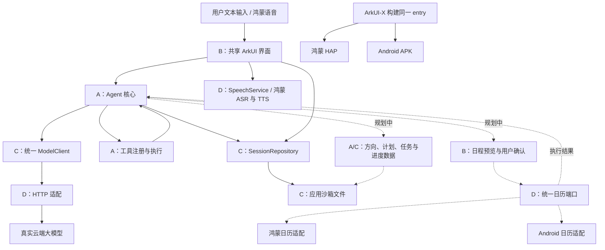

# 一页纸架构

**产品定位：** 面向大学生的学习方向与行动规划 Agent。从考研、就业等目标出发，帮助用户探索学习路径、制定阶段计划、安排学习时间，并通过日历工具和进度反馈持续调整。同一份 ArkTS 业务与 ArkUI 页面通过 ArkUI-X 产出鸿蒙 HAP 和 Android APK。

图中实线表示现有框架的代码职责与依赖，仍需按验收清单联调；虚线表示本产品方向拟新增的能力，尚未实现。日历等新增公共端口在接口评审后加入 `contracts/`。

**模块边界：** A 管方向访谈、规划、工具与反馈调整，B 管共享 UI、候选方向和日程预览确认，C 管云模型与本地数据，D 管平台 API、日历适配、语音和构建。现有公共数据与端口在 `contracts/`，`bootstrap/DeviceRuntime.ets` 集中注入实现；日历平台差异也集中在适配层。

**目标流程：** 目标访谈 → 用户选择学习路径 → 生成阶段计划与近期任务 → 按可用时段排期 → 预览并确认 → 写入系统日历 → 用户反馈完成情况 → 调整后续计划并确认更新。计划书、任务列表和日程共享任务数据；方向不明确时先给候选路径和短期尝试任务。

**现有执行流程与状态：** 输入先存历史 → Agent 携带上下文请求模型 → 校验并执行工具 → 回传结果 → 保存答复并展示。语音识别文本复用相同入口。`idle → thinking → using_tool → thinking → completed`，模型或存储异常进入 `failed`；每轮最多 4 次模型推理、每步最多 8 个工具请求，同会话禁止并发发送。现有状态机尚未加入日历写入前的用户确认，需要在新增工具时补齐。

**日历执行设计（待实现）：** 写入前预览日期、起止时间与提醒设置；用户确认后调用平台适配。授权读取日历后可检查已有日程冲突，未授权时使用用户提供的空闲时段。保存任务与日程 ID 映射，避免重复写入，仅更新或删除本应用创建的日程；部分失败逐项反馈，保留应用内计划。

**数据与配置：** 当前历史仓库提供应用私有目录 JSON 文件适配源码，设备持久化待双端实测；用户条件、学习路径、计划版本、任务进度和日程 ID 映射为待扩展数据。模型密钥仅在运行时配置中使用。初期采用本地数据与云模型组合。

**交付边界：** 当前有共享代码、最小学习计划工具、模拟/云端协议适配、文件存储适配源码与检查脚本。真实模型、鸿蒙语音、原生工程和双端安装仍需联调；方向探索、约束排期、日历工具、计划书页面和反馈调整尚未实现。首版细化未来一周日程，计划书先在应用内展示，文档导出后续扩展。任务见[四人分工与里程碑](四人分工与里程碑.md)，验证见[验收清单](验收清单.md)。
