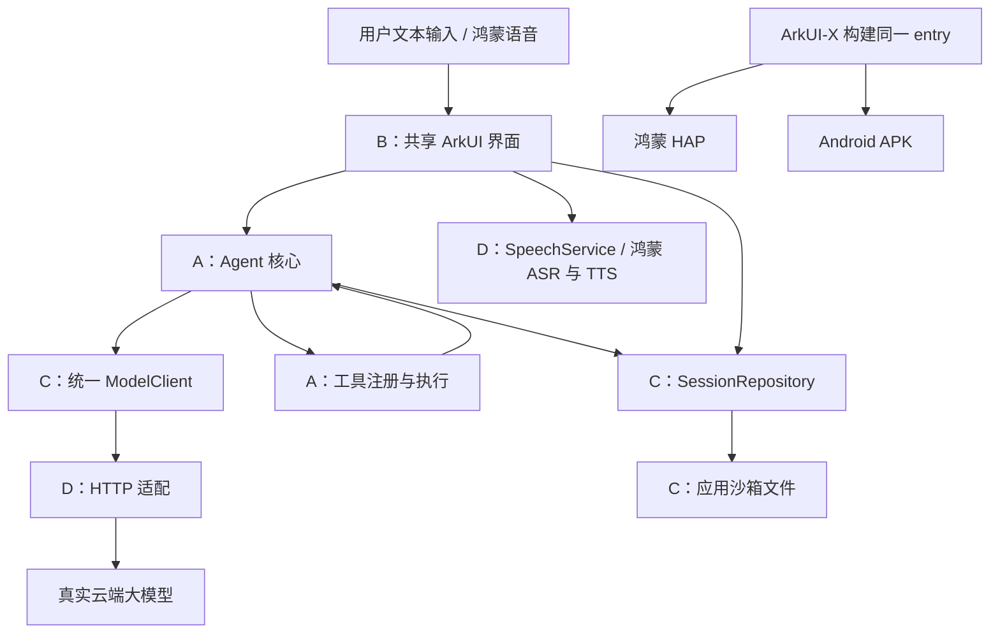

# 一页纸架构

**目标：** 面向大学生具体痛点的 Agent 应用，同一份 ArkTS 业务与 ArkUI 页面通过 ArkUI-X 产出鸿蒙 HAP 和 Android APK。当前示例为学习任务助手，选题可替换。

**模块边界：** A 管任务和工具，B 管共享 UI，C 管云模型与历史，D 管平台 API、语音和构建。所有公共数据与端口定义在 `contracts/`；`bootstrap/DeviceRuntime.ets` 集中注入实现。UI 不接触供应商 HTTP 协议，Agent 不导入平台 Kit。

**主流程：** 新建/恢复会话 → 用户输入 → 先存历史 → Agent 携带多轮上下文请求模型 → 有工具请求则校验和执行，并把结果交回模型 → 得到答复后保存 → UI 展示。语音识别产生的文本复用同一路径，播报失败保留文本。

**状态与失败：** `idle → thinking → using_tool → thinking → completed`；模型或存储异常进入 `failed`。缺信息先澄清；工具失败返回结构化结果；每轮最多 4 次模型推理、每步最多 8 个工具请求；同会话禁止并发发送。工具请求及对应结果成组写入，损坏历史拒绝覆盖。

**数据与配置：** 设备历史存于应用私有目录的 JSON 文件，支持回看和删除；模型密钥仅在运行时配置中使用，不写历史或源码。初期不要求后端服务；后续可在模型适配层增加代理。

**交付边界：** 当前有共享代码、示例工具、模拟/云端协议适配、文件存储适配源码和检查脚本。完整原生工程由官方模板按团队所用 SDK 生成；真实云服务、鸿蒙语音和两端安装需继续联调。工程结构采用 [ArkUI-X 官方结构](https://github.com/arkui-x/docs/blob/master/zh-cn/application-dev/quick-start/package-structure-guide.md)。
