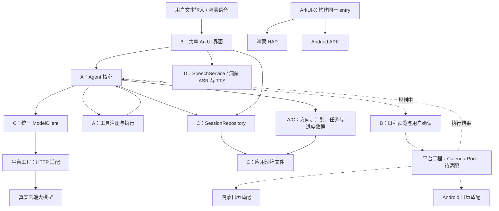

# 一页纸架构

**产品定位：** 面向大学生的学习方向与行动规划 Agent。从考研、就业等目标出发，帮助用户探索学习路径、制定阶段计划、安排学习时间，并通过日历工具和进度反馈持续调整。同一份 ArkTS 业务与 ArkUI 页面通过 ArkUI-X 产出鸿蒙 HAP 和 Android APK。

图中实线表示现有共享代码职责与依赖，仍需按验收清单联调；虚线表示 B 的产品界面与 平台设备适配待接入。A 的业务和可信确认编排已实现，新增公共数据与端口在 `contracts/LearningModels.ts`、`LearningPorts.ts`。

**模块边界：** A 管方向访谈、规划、工具与反馈调整，B 管共享 UI、候选方向和日程预览确认，C 管云模型与本地数据，D 管语音；日历、平台 API 与构建由平台工程协作。现有公共数据与端口在 `contracts/`，`bootstrap/DeviceRuntime.ets` 集中注入实现；日历平台差异也集中在适配层。

**目标流程：** 目标访谈 → 用户选择学习路径 → 生成阶段计划与近期任务 → 按可用时段排期 → 预览并确认 → 写入系统日历 → 用户反馈完成情况 → 调整后续计划并确认更新。计划书、任务列表和日程共享任务数据；方向不明确时先给候选路径和短期尝试任务。

**现有执行流程与状态：** 输入先存历史 → Agent 携带聊天与业务上下文请求模型 → 校验并执行工具 → 回传结果 → 保存答复。语音文本复用相同入口。`idle → thinking → using_tool → thinking → completed`，失败进入 `failed`；每轮最多 4 次模型推理、每步最多 8 次工具请求。持久预览单独表示待确认状态，不能用 completed 判断计划或日历是否成功；B 的可信确认入口不暴露给模型。send、删除及规划确认有会话协调保护。

**日历执行：** A 已实现预览版本绑定、确认/取消、逐项持久意图与回执、重试前核对与日程 ID 映射；平台工程仍需实现并验证 readBusy/reconcile/apply。读取未授权时使用手工时段，未注入日历则明确不可用。只更新本应用可核验的未来未完成日程；过去及已完成关联保持，部分失败保留计划。取消 unknown 项只核对、不补写。

**数据与配置：** 业务 JSON 与聊天分开保存，已记录用户条件、路径、当前计划版本、任务进度、预览/取消意图、逐项结果与日程关联，并拒绝损坏或版本不兼容数据。会话、基础计划及方向规划共用设备文件端口，使用不同 key。基础计划页支持计划回看和打卡，持久化仍待双端实测。密钥仅在运行时配置使用。

**交付边界：** A 的访谈候选、2–4周阶段任务、一周排期、日历工具编排及反馈调整已做共享逻辑检查。主 demo 是 JSON 模拟模型与内存日历，不能代替真实模型、计划书界面、鸿蒙语音、双端日历和安装验收。详细入口见[A 实现与交接](Agent学习方向与行动规划说明.md)，验证见[验收清单](验收清单.md)。

主分支的 API 24 整合原型已有未签名 HAP 构建与鸿蒙模拟器启动记录，见[整合与联调](整合与联调.md)。本分支新增 Agent 后需重新做原生构建。
